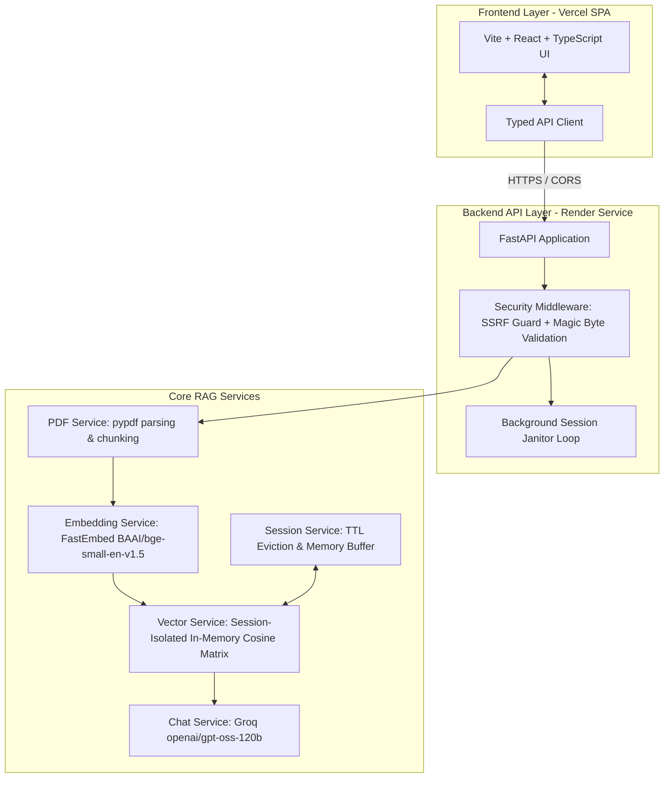

# PDF Intelligence — RAG Document Chat Application

A production-grade, full-stack Retrieval-Augmented Generation (RAG) monorepo application designed to allow users to upload or reference PDF documents, ask grounded questions, receive verified page citations, and maintain multi-turn conversational context with strict document isolation.

---

## 1. Monorepo Architecture

```
rag-document-chat/
├── backend/                             # Python 3.12 FastAPI RAG API
│   ├── app/
│   │   ├── api/routes/                  # Health, Documents, Chat routes
│   │   ├── core/                        # Settings, Errors, Sanitized Logging
│   │   ├── models/                      # Pydantic v2 Request/Response schemas
│   │   ├── security/                    # SSRF prevention, Upload sniffer
│   │   ├── services/                    # PDF parser, FastEmbed, Vectors, Sessions, Groq LLM
│   │   ├── tests/                       # 22 automated unit/integration tests
│   │   └── main.py                      # ASGI application entrypoint & lifespan
│   ├── requirements.txt                 # Production dependencies
│   ├── requirements-dev.txt             # Development & test tools
│   ├── .env                             # Real local environment file (git-ignored)
│   ├── .env.example                     # Trackable environment template
│   └── README.md
├── frontend/                            # Vite + React + TypeScript Client Foundation
│   ├── public/                          # Static assets
│   ├── src/
│   │   ├── components/                  # Reusable UI elements (Phase 3)
│   │   ├── features/                    # Upload & Chat views (Phase 3)
│   │   ├── services/                    # Typed API client
│   │   ├── styles/                      # CSS custom properties & design tokens
│   │   ├── types/                       # TypeScript models mirroring backend schemas
│   │   ├── App.tsx                      # Main application view
│   │   └── main.tsx                     # React DOM entrypoint
│   ├── package.json
│   ├── tsconfig.json
│   ├── vite.config.ts
│   ├── .env.example
│   └── README.md
├── ragusinglangchainandtools.ipynb      # Original Colab research notebook (Preserved)
├── pytest.ini                           # Pytest configuration
├── ruff.toml                            # Linter configuration
├── .gitignore                           # Credentials, caches, venv protection
└── README.md                            # Monorepo documentation (This file)
```

---

## 2. Architecture Diagram



---

## 3. Technology Stack

| Domain | Technology | Key Responsibility |
| :--- | :--- | :--- |
| **Backend Framework** | FastAPI (0.143+) / Uvicorn | High-performance ASGI REST endpoints with automatic OpenAPI documentation |
| **Data Validation** | Pydantic v2 / Pydantic-Settings | Strict request/response typing and environment parsing |
| **Embeddings** | FastEmbed (`BAAI/bge-small-en-v1.5`) | Ultra-lightweight CPU ONNX embeddings (~67MB memory, 384 dim, 5ms/query) |
| **Vector Storage** | Isolated In-Memory Cosine Matrix | Zero external DB overhead, mathematically isolated per session UUID |
| **LLM Provider** | Groq (`langchain-groq`, `ChatGroq`) | Ultra-fast inference with `openai/gpt-oss-120b` or configurable models |
| **PDF Ingestion** | `pypdf` | Byte signature checks, page-count limits, and scanned-document detection |
| **Testing** | Pytest / Pytest-Asyncio | 22 comprehensive offline tests covering edge cases |
| **Linting & Code Quality**| Ruff (0.17+) | Fast Python linter and code formatter |
| **Frontend Foundation** | Vite + React + TypeScript | Modern single-page web client deploying to Vercel |

---

## 4. Local Development Workflow

### Backend Setup
1. **Navigate to backend and install requirements:**
   ```bash
   pip install -r backend/requirements.txt
   pip install -r backend/requirements-dev.txt
   ```

2. **Configure your Groq API key:**
   Open `backend/.env` and insert your actual key:
   ```env
   GROQ_API_KEY=gsk_your_groq_api_key_here
   GROQ_MODEL_NAME=openai/gpt-oss-120b
   ```

3. **Run automated test suite:**
   ```bash
   python -m pytest -v
   ```

4. **Start local FastAPI server:**
   ```bash
   python -m uvicorn backend.app.main:app --host 127.0.0.1 --port 8000 --reload
   ```
   Interactive API documentation: `http://localhost:8000/docs`.

### Frontend Setup (Preview)
1. **Navigate to frontend directory:**
   ```bash
   cd frontend
   cp .env.example .env
   ```
2. The interactive UI will be implemented in **Phase 3**.

---

## 5. Security & Isolation Controls

1. **SSRF Prevention:** Remote PDF ingestion resolves DNS and strictly blocks IPv4/IPv6 private ranges (RFC 1918), loopback (`127.0.0.1`), link-local (`169.254.169.254`), and cloud metadata services.
2. **Document Isolation:** Every document creates a dedicated UUID session. Vectors for Session A and Session B are stored in separate numpy matrices; cross-document leakage is mathematically impossible.
3. **Magic Byte Verification:** Uploaded files must match the `%PDF-` signature.
4. **Prompt Injection Containment:** Retrieved chunks are isolated within `<document_context>` XML tags with strict system instructions treating text as data, not instructions.
5. **Secret Protection:** `GROQ_API_KEY` is loaded strictly on the backend and git-ignored. It is never transmitted to the frontend.

---

## 6. Deployment Guides

### Render Backend Deployment
1. Connect the GitHub repository to [Render](https://render.com).
2. Create a new **Web Service**.
3. Set **Root Directory** to `backend`.
4. Set **Runtime** to `Python 3`.
5. Set **Build Command:** `pip install -r requirements.txt`.
6. Set **Start Command:** `uvicorn app.main:app --host 0.0.0.0 --port $PORT --workers 1`.
7. Configure Environment Variables in Render Dashboard:
   - `GROQ_API_KEY`: `gsk_...`
   - `GROQ_MODEL_NAME`: `openai/gpt-oss-120b`
   - `APP_ENV`: `production`
   - `CORS_ORIGINS`: `["https://your-frontend.vercel.app"]`

### Vercel Frontend Deployment
1. Connect the GitHub repository to [Vercel](https://vercel.com).
2. Set **Root Directory** to `frontend`.
3. Set **Framework Preset** to `Vite`.
4. Set Environment Variable in Vercel Dashboard:
   - `VITE_API_BASE_URL`: `https://your-render-backend.onrender.com`
5. Deploy.
